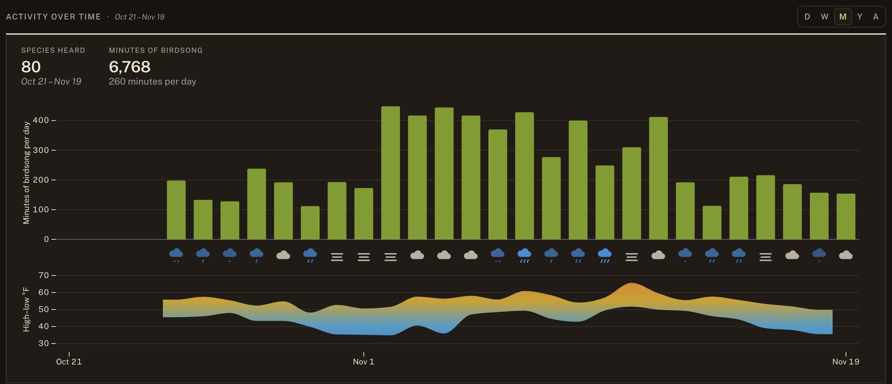
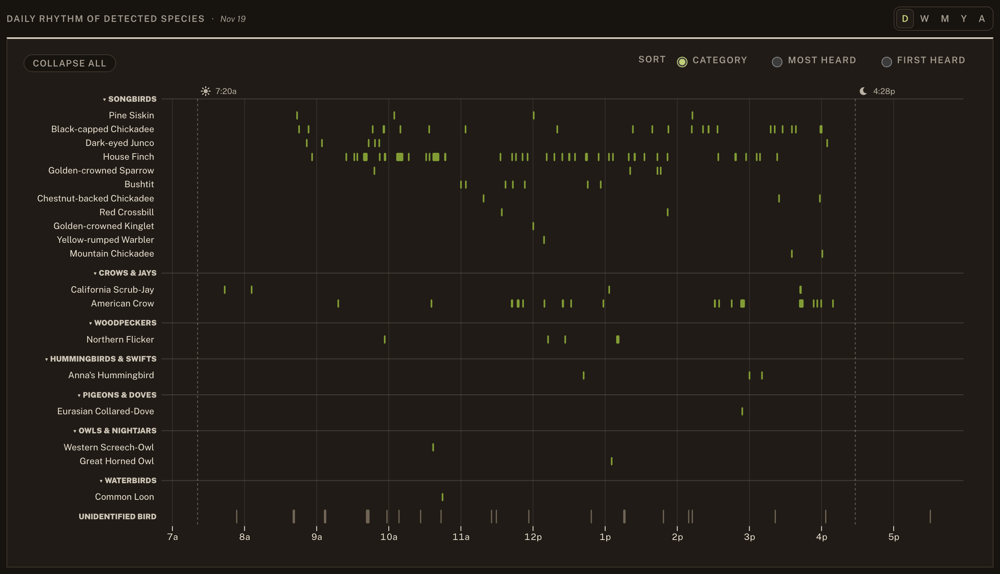
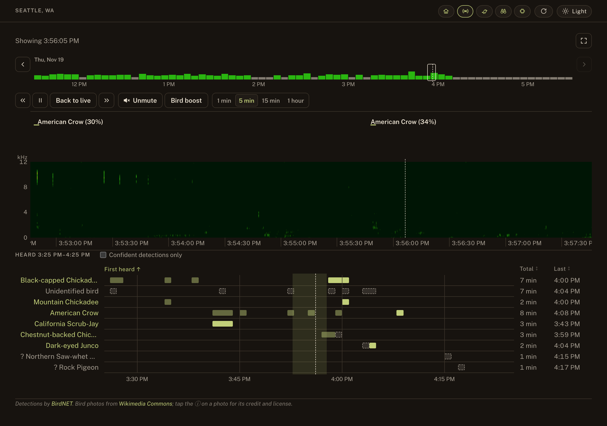
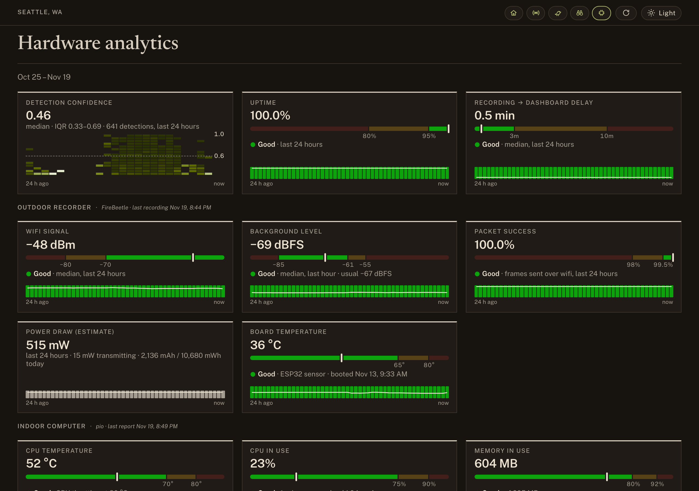

# Bird Tracker

Bird Tracker identifies birds by their songs and calls, and shows what it heard
on a web dashboard. An outdoor recorder, a DFRobot FireBeetle 2 ESP32-E with an
INMP441 I²S microphone, streams audio over Wi-Fi to a Raspberry Pi 3B+ indoors.
The Pi identifies birds with
[BirdNET](https://github.com/birdnet-team/BirdNET-Analyzer) and publishes the
results to a dashboard.









## Quickstart

To run the dashboard on simulated data, install Python 3.12 or later and
Node.js 18 or later, or use the conda environment in `environment.yml`. Then,
from the repository root, run the following commands:

```bash
python3 -m venv .venv
.venv/bin/pip install -r requirements.txt
npm --prefix dashboard install
.venv/bin/python pipeline/simulate.py
npm --prefix dashboard run dev
```

Then open `http://localhost:3000`. For details, see
[Development](docs/development.md).

## Repository layout

The following table describes the top-level folders:

| Path | Contents |
| --- | --- |
| `pipeline/` | Python services for the indoor computer, and scripts that build reference data |
| `dashboard/` | The Observable Framework site and its data loaders |
| `deploy/` | The Cloudflare Worker, its Wrangler configuration, and the Raspberry Pi services |
| `firmware/` | Bench recorder firmware |
| `data/` | Checked-in reference data, and generated data that Git ignores |
| `docs/` | Documentation |

## Documentation

The following table lists the documentation pages:

| Page | Read it to |
| --- | --- |
| [Architecture](docs/architecture.md) | Understand the components, the data flow, and the design decisions |
| [Development](docs/development.md) | Run the dashboard and pipeline locally, run tests, and regenerate reference data |
| [Deploy](docs/deploy.md) | Deploy the website, the R2 bucket, and the indoor computer |
| [Recorder hardware](docs/hardware.md) | Build the bench recorder and compare outdoor builds |
| [Status](docs/status.md) | See what is deployed, in progress, or unverified |
| [Bench test 1](docs/bench-test-1.md) | See the first bench test's results |
| [Agent and contributor guide](AGENTS.md) | Follow the rules for branches, commits, checks, and documentation |

The `docs/design/` folder holds design artifacts. Open them in a browser:

- [Recorder hardware options](docs/design/hardware-design.html): candidate
  builds, energy estimates, and component choices.
